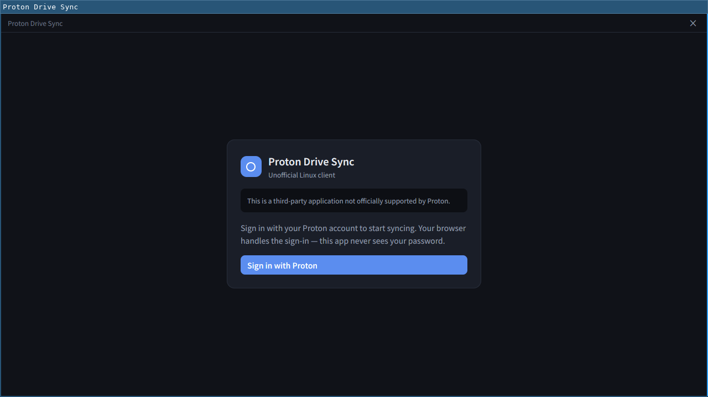
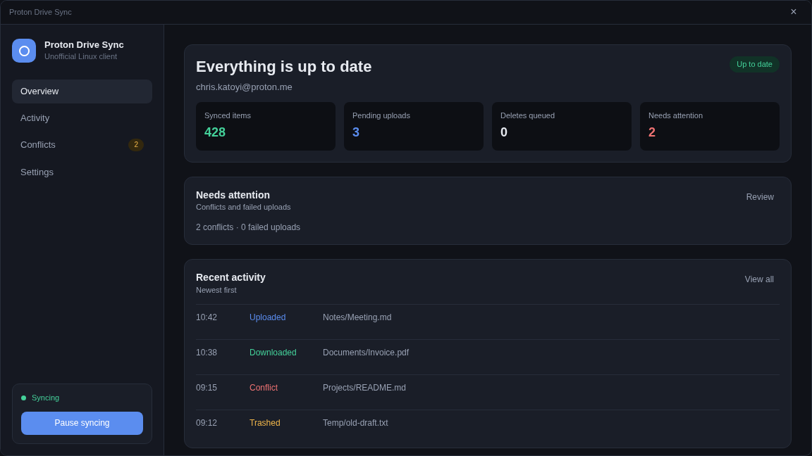
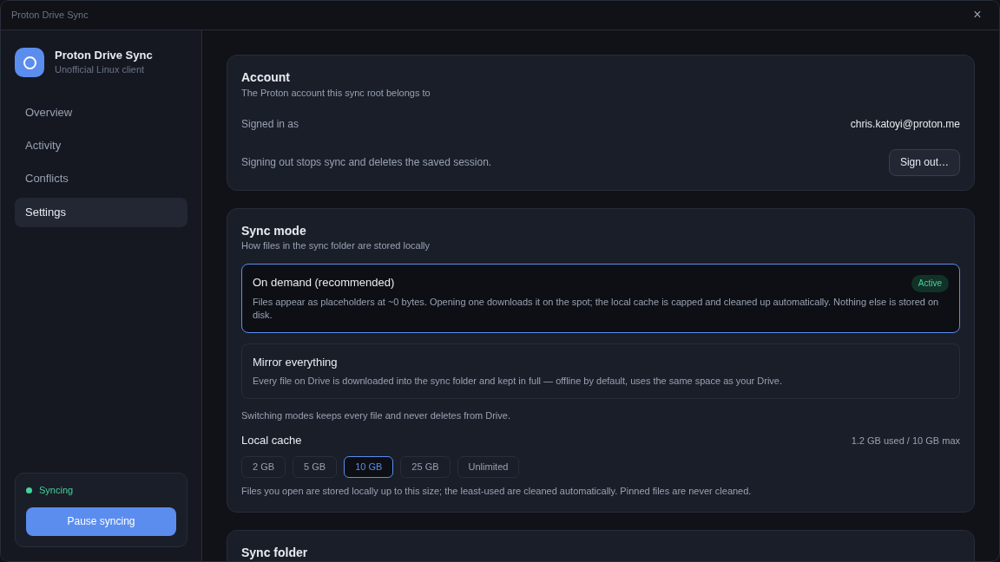
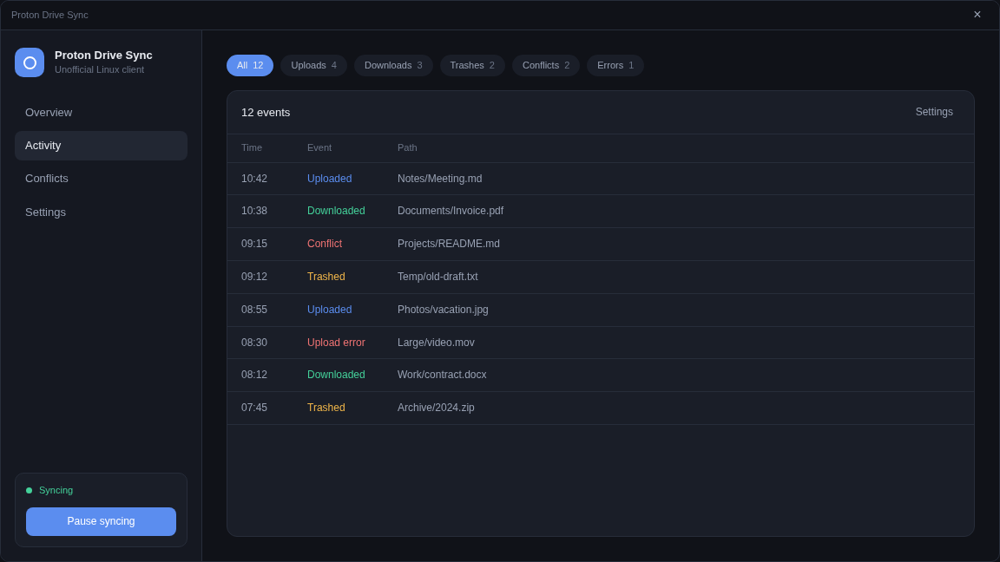
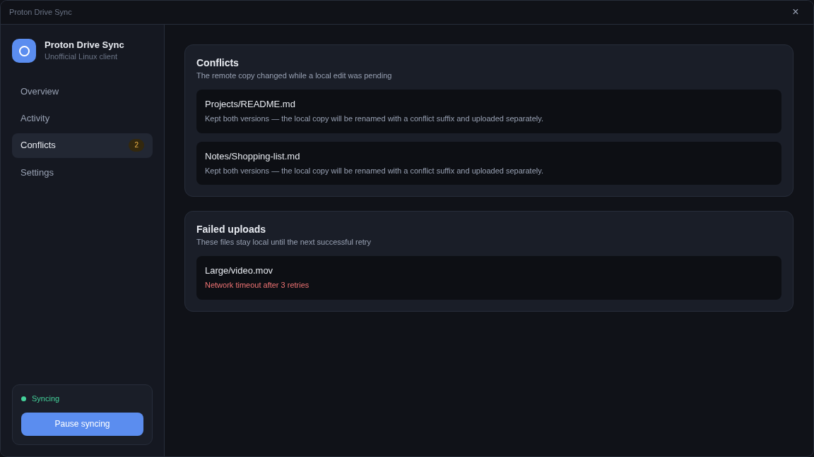

# Proton Drive Sync

> **Experimental, unofficial, and used at your own risk.** Not affiliated with
> Proton. Built for my own personal use case; I am not responsible for any data
> loss. See [Read this first](#read-this-first-important).

A **Linux** desktop app that syncs a folder with [Proton Drive](https://proton.me/drive).



- Your whole Drive appears in `~/ProtonDrive` at ~0 bytes.
- Files hydrate when opened.
- A capped local cache keeps SSD usage near zero.
- Prefer everything offline? A Settings toggle switches the same folder to full **mirror** mode.

| | |
|---|---|
|  |  |
|  |  |

- **Product spec:** [SPEC.md](SPEC.md) — source of truth
- **Agent notes:** [AGENT.md](AGENT.md)

Stack: Rust + GPUI (native Linux desktop UI) · Node.js sidecar running the official [Proton Drive SDK](https://github.com/ProtonDriveApps/sdk) · SQLite state. (macOS and Windows were supported in an earlier iteration and have been dropped.)

## Read this first (important)

- **Experimental.** This project is a work in progress and is **not** ready for
  production or for data you cannot afford to lose. Expect bugs, sync edge
  cases, and breaking changes.
- **Not affiliated with Proton.** This is an independent, third-party project.
  It is not endorsed by, supported by, or connected to Proton AG in any way,
  and it is not an official Proton product.
- **Personal project.** I built this for my own personal use case. With Proton
  Drive now having an [official SDK](https://github.com/ProtonDriveApps/sdk), I
  wanted to build a Linux desktop sync client on top of it for fun and for my
  own workflow. Your needs may differ.
- **Use at your own risk.** I am **not responsible for any data loss** or
  corruption caused by using this software. Keep independent backups of
  anything important before pointing this at a folder.

If any of that is a dealbreaker, please use the official Proton Drive apps
instead.

## Features

### On-demand placeholders by default

The sync root is a FUSE view of your Drive. Every file is visible at ~0 bytes,
hydrating on open, with an LRU-capped local cache (default 10 GiB). Nothing
downloads until you use it.

### Switch to mirror mode at any time

**Settings → Sync mode** switches the same folder between *On demand* and
*Mirror everything*. Switching moves existing content (no re-download) and never
deletes from Drive.

### Two-way sync with conservative deletes

- Upload on new/changed files.
- Local deletes are sent to the Proton Drive Trash, never permanently deleted.
- A mass-deletion guard pauses sync when too many files are deleted at once.

### Native desktop integration

- Single main window with **Overview**, **Activity**, **Conflicts**, and **Settings** pages.
- Optional **start at login** via XDG autostart.
- **Tray icon** with status dot, pause/resume, open folder, and quit.
- Closing the dashboard hides the app to the tray; sync keeps running.

### CLI companion

`pds sync` runs the engine headless; `pds status|pause|resume` control a running
engine; `pds mount <folder> <mountpoint>` serves a placeholder view anywhere. See
`pds --help`.

## Install

### Nix (recommended on NixOS or Nix-enabled distros)

```sh
# Try without installing
nix run .#proton-drive-sync

# Install app + CLI + sidecar into a profile
nix profile install .#default
```

Or install straight from GitHub:

```sh
nix profile install github:Christopher2K/proton-drive-sync-linux
```

### From source

```sh
# 1. Enter the pinned development environment
devenv shell

# 2. Build
cargo build --release -p pds-app -p pds-cli

# 3. Install system-wide (or PREFIX=$HOME/.local for a user install)
sudo packaging/linux/install.sh
```

### From a release tarball

Download `proton-drive-sync-<version>-<arch>.tar.xz` from
[GitHub Releases](https://github.com/Christopher2K/proton-drive-sync-linux/releases),
then run:

```sh
tar -xJf proton-drive-sync-*.tar.xz
sudo proton-drive-sync-*/install.sh
```

`.deb` and `.rpm` packages are also published on releases (require `nodejs >= 20`
and `npm` at runtime).

## First launch

1. Open **Proton Drive Sync** from your application menu.
2. Click **Sign in with Proton**. Your browser handles login; the app never sees
   your password.
3. Choose your sync folder (default: `~/ProtonDrive`).
4. The app starts syncing in the background. Close the window to keep it in the
   tray.


## Development environment (devenv)

The Rust toolchain (pinned in `rust-toolchain.toml`), Node.js, and every native
library GPUI/FUSE need are declared in `devenv.nix` and locked in
`devenv.lock`, so local development and CI build against the same environment.

Install [Nix](https://nixos.org/download) and [devenv](https://devenv.sh/getting-started/)
once, then from the repository root:

```sh
devenv shell        # enter the environment
# or, with direnv installed: direnv allow
```

`devenv test` builds the environment and runs the full test suite. FUSE tests
additionally need the host's setuid `fusermount3` (package `fuse3`), which Nix
cannot provide; the shell points `fuser` at the host binary automatically.

## Build (Linux)

```sh
cargo build --release -p pds-app -p pds-cli
```

A GPU stack for GPUI (Vulkan/Mesa; under a Wayland or X11 session this is
already present) is not part of devenv — it is host-specific.

Run from the repository root (dev mode — the sidecar is found relative to the repo):

```sh
cargo run -p pds-app
```

Environment knobs:

| Var | Meaning |
|---|---|
| `PDS_SYNC_ROOT` | Sync folder (default: `~/ProtonDrive`) |
| `PDS_SYNC_MODE` | `placeholders` (on demand) or `mirror` (materialize everything); session-only override of the persisted Settings choice (never rewrites it) |
| `PDS_CACHE_CAP` | Backing-cache cap: bytes with an optional `K`/`M`/`G`/`T` suffix (`500M`, `10G`) or `unlimited`; session-only override of the persisted Settings choice (never rewrites it). `pds mount --cache-cap <SIZE>` overrides both for one invocation |
| `PDS_SIDECAR_CMD` | Sidecar command override, e.g. `node sidecar/dist/index.js` |
| `PDS_SIDECAR_DIR` | Sidecar directory override for auto-discovery |
| `RUST_LOG` | Log filter (default `info,pds_core=debug`), logs go to stderr |

## Background service and tray

The app **is** the sync service: the engine, the on-demand mount, and the tray
live in one long-running process, so closing the dashboard never interrupts a
transfer.

- **Start at login** is on by default for installed builds (development
  builds from `target/` stay opt-in). `Settings → Startup` toggles it. The app
  writes the standard XDG entry
  `~/.config/autostart/proton-drive-sync.desktop`, launching
  `proton-drive-sync --minimized` a few seconds after you sign in to your
  desktop session. `--minimized` always wins: a login start never opens a
  window, even if the panel (and its tray host) has not come up yet. The
  dashboard opens only when you ask for it. Your choice is remembered in
  `~/.config/proton-drive-sync/app.conf`; toggling it off removes the entry
  and a later launch will not re-enable it.
- **Tray icon** (StatusNotifierItem): a coloured dot shows syncing, paused,
  delete-guard, signed-out, or stopped. The menu has *Open Dashboard*,
  *Pause/Resume syncing*, *Open Sync Folder*, *Preferences…*, and *Quit*;
  left-clicking the icon opens the dashboard. Closing the dashboard hides it
  (the window is unmapped, syncing continues), and `Quit` is the only way to
  stop the service.
- **No tray host?** GNOME needs the AppIndicator extension, and some bare
  compositors (e.g. niri) need a panel such as waybar with a tray module.
  Without a `StatusNotifierWatcher` the app still starts at login and syncs
  windowless; start it again (application menu or
  `proton-drive-sync`) to open the dashboard, and closing the window then
  stops the service because there is no icon to bring it back.
- **One instance only:** launching `proton-drive-sync` again does not start a
  second engine — it asks the running instance to show its dashboard
  (`$XDG_RUNTIME_DIR/proton-drive-sync.sock`) and exits. This protects the
  SQLite state and the FUSE mount from two writers.

## Releases

Releases are versioned as a single product (`MAJOR.MINOR.PATCH`, semver while
pre-1.0: breaking changes bump the minor). One version is shared by the app,
CLI, sidecar, and Nix packages — `scripts/check-versions.sh` enforces this in
CI.

To cut a release (inside the devenv shell, so `git-cliff`, `cargo` and `gh` are
available):

```sh
scripts/release.sh minor        # or: patch | major
```

The script bumps every version site, regenerates `CHANGELOG.md` from
conventional commits, and opens a `release/vX.Y.Z` PR titled
`chore(release: vX.Y.Z)` (review and squash-merge it like any other change —
`main` is protected). Once the PR merges, the Tag Release workflow
(`.github/workflows/tag-release.yml`) sees the new workspace version, tags
`vX.Y.Z`, and dispatches the release workflow, which builds on Ubuntu 22.04
(binaries run on glibc ≥ 2.35) for amd64 and arm64 and publishes to
[GitHub Releases](https://github.com/Christopher2K/proton-drive-sync-linux/releases):

- `proton-drive-sync-<version>-<arch>.tar.xz` — binaries + vendored sidecar +
  `install.sh`; untar and run `sudo install.sh` (or `PREFIX=$HOME/.local …`)
- `.deb` / `.rpm` packages (require `nodejs >= 20` and `npm` at runtime)
- `checksums.txt` (sha256)

## Testing

```sh
devenv test                     # Rust workspace + sidecar typecheck/tests
devenv shell -- cargo test --workspace   # Rust only, inside the env
```

Notes for VM development (OrbStack et al.): inotify over shared folders is unreliable — run the engine tests on VM-native disk. See [AGENT.md](AGENT.md) for details.

## License

[MIT](LICENSE)
