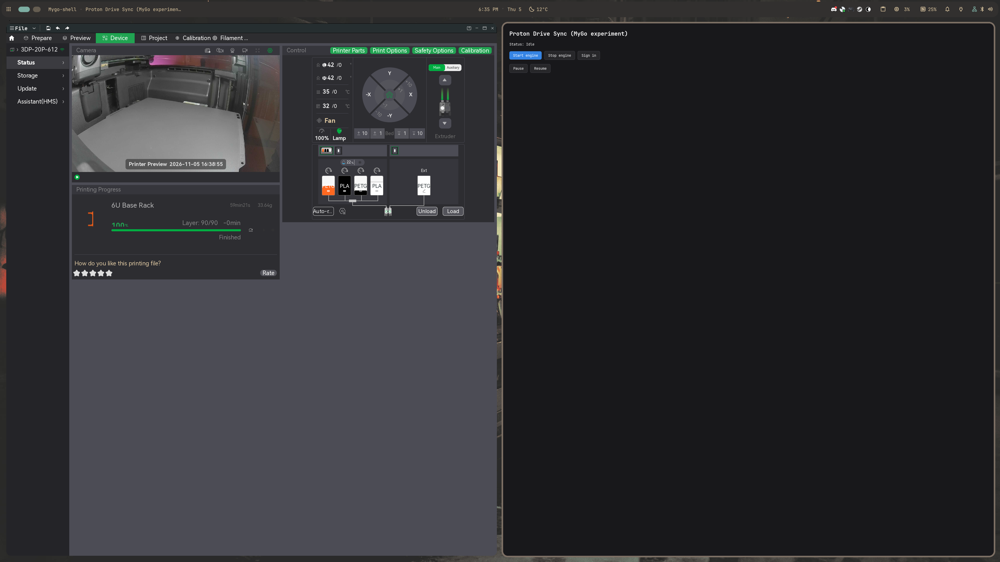
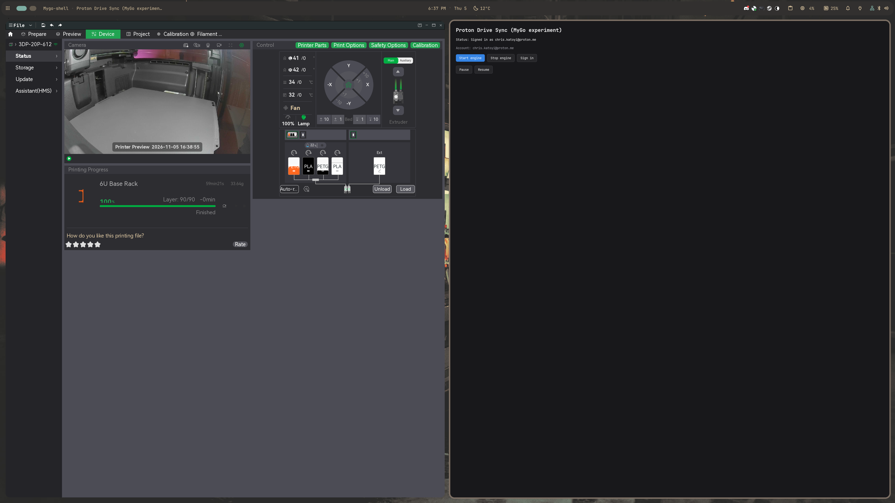

# MyGo migration Phase 1 proof-of-concept

**Goal:** verify that a MyGo-native UI shell can launch and control the existing
Rust sync engine without rewriting the engine, FUSE placeholder view, or sidecar.

## What was built

- `crates/engine-headless/` — new binary `pds-engine-headless` that reuses the
  same engine orchestration as `crates/app/src/engine.rs` and exposes a
  JSON-line control protocol over a Unix domain socket.
- `mygo-shell/` — MyGo-native Linux desktop UI (`mygo init -template native`)
  with Start/Stop engine, Sign in, Pause, and Resume buttons.

The shell and engine communicate over a Unix socket:

- **Commands (shell → engine):** `{ "cmd": "StartLogin" | "Pause" | "Resume" | "Shutdown" }`
- **Updates (engine → shell):** JSON lines mirroring `AppUpdate`, e.g.
  `AuthRequired`, `AuthOk`, `LoginUrl`, `EngineStarted`, `Status`, `Activity`,
  `Exited`, `Failed`.

Default socket path: `$XDG_RUNTIME_DIR/pds-mygo-engine.sock`  
Default sync root: `/tmp/pds-mygo-root` (override with `PDS_SYNC_ROOT`)

## Build instructions

```sh
# 1. Build the headless engine
cargo build -p pds-engine-headless

# 2. Build the MyGo shell
cd mygo-shell
go tool mygo build

# 3. Run (inside the devenv shell so GTK/GLib/Wayland libs are available)
cd ..
devenv shell
export PDS_ENGINE_BIN=$PWD/target/debug/pds-engine-headless
export PDS_SYNC_ROOT=/tmp/pds-mygo-root
./mygo-shell/build/linux-amd64/mygo-shell
```

For demo/development you can auto-start the engine on launch:

```sh
MYGO_AUTO_START=1 ./mygo-shell/build/linux-amd64/mygo-shell
```

## Screenshot proof

Idle shell before starting the engine:



Shell after auto-starting the engine and authenticating from the existing
session:



The status line reads **"Signed in as chris.katoyi@proton.me"** and the
account label is visible, confirming that the MyGo UI received `AuthOk` and
`EngineStarted` updates over the control socket while the engine performed its
initial sync.

## What worked

- `cargo build -p pds-engine-headless` succeeds.
- `go tool mygo build` succeeds.
- The headless engine spawns the sidecar, authenticates from the existing
  session, mounts the placeholder view, and streams state updates over the
  socket.
- The MyGo shell opens a native Linux window, connects to the socket, and
  updates its UI in response to engine events.
- Existing Rust workspace tests still pass (`devenv shell -- cargo test
  --workspace --all-targets`).

## Known limitations / blockers

1. **Shutdown during pre-mount startup.** If the engine is still in the
   sidecar-auth / FUSE-probe / layout-migration window before
   `drive_engine_task` starts, the `Shutdown` command is not consumed and the
   shell falls back to `Process.Kill()` after 3 s. Fixing this would require
   consuming commands during that early window.

2. **Full login flow not exercised.** The PoC reused the existing saved
   session, so the `AuthRequired` → `StartLogin` → `LoginUrl` → browser →
   `Running` path was not run end-to-end without potentially opening the user's
   browser.

3. **Dependency on devenv runtime libs.** MyGo's Linux backend dynamically
   loads GLib/GDK. Running the built binary outside the devenv shell (or
   without the equivalent library path) fails with "cannot load
   libglib-2.0.so.0". This is expected for a GTK-based UI and is solved by the
   devenv `LD_LIBRARY_PATH`.

4. **No tray / autostart / settings yet.** Phase 1 is intentionally just a
   control shell; the existing GPUI app still owns tray, autostart, and the
   full settings UI.

## Recommendation

The Phase 1 PoC **succeeds**. The MyGo shell can drive the real Rust sync
engine over a simple socket protocol without touching the engine, FUSE, or
sidecar code. The next step, if the project decides to continue, would be to
implement the remaining GPUI surface in MyGo (tray, settings, activity/conflicts
views) and promote `pds-engine-headless` to a first-class background service
with a stable control protocol.

For now this remains an experiment: the existing GPUI app is unchanged and
continues to be the supported Linux UI.
